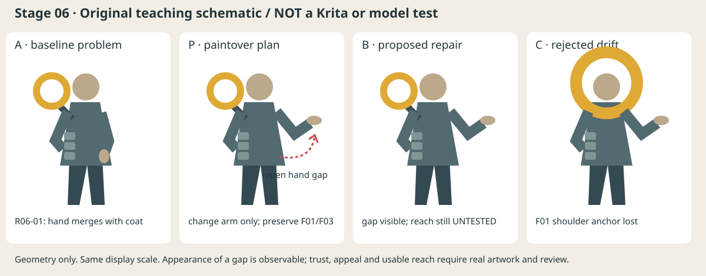

# 阶段六｜雾港引路人评审闭环（教学演练）

项目：岑灯；日期：2026-10-15；执行：AI 编写原创几何示意和记录；人类决策者：未确认。输入：[意图卡](雾港引路人_意图卡.md)、[阶段五 D01](雾港引路人_方向决策.md)。P-A 仍是教学暂选，F01–F03 仍暂定。真实阶段四证据、真实主稿、人工锁定、Krita/模型实跑、真人评阅均缺失。以下“接受/拒绝/撤回”是如何填写的模拟，不是用户已做决定。

## 最小卡

| 项目 | 本例填写 |
|---|---|
| 项目 / 阶段 / 版本 | 雾港引路人 / 06 / 演练 v01 |
| 输入版本 | 上述意图与 D01；P-A 暂选；本例 A 另画的几何简图，不替换原阶段五候选板 |
| 本轮唯一问题 | R06-01：F02 的空手要可见；A 画面右侧手贴衣摆，黑剪影时轮廓合并；试打开手臂负形 |
| 执行者与决策者 | AI 制作示意；决策者待指定；结论全为演练 |
| 比较条件 / 不可退化 | 四格同画幅/背景/身体尺度；保留肩侧空心灯 F01、开放面部与空手 F02、三段腰片 F03 |
| 修复 / 反证 | 改画面右侧手臂为向外伸出；若更像拒绝、攻击，或动作不能接人，则空隙再清楚也不代表成功 |
| 产物及证据状态 | [A/P/B/C 对照示意](阶段六_雾港引路人_画改示意.svg)，仅文档/原创几何示意；真实作品/工具实测/真人评阅待验证 |
| 结论 / 下一步 | 几何间隙存在可观察；“更可靠”“伸手可用”“更有吸引力”未证实；补真实伸手侧视并由人确认 |

## 怎样读对照图

左至右是 A 原问题、P 画改方向、B 候选修复、C 失败对照。全图是重新绘制的 SVG 形块，不是从 Krita 截图，不是真实 Paintover 过程，不是模型返回图。P 的虚线箭头只说明修改方向；它与 B 同形，正好说明“画改示意”和“模型/真人完成结果”不能用两幅相似图伪造。

| 图像中实际可观察 | 仍是推断或待验证 |
|---|---|
| A 的画面右手与衣摆相接；B 的手臂与身体之间形成开口；人物头/躯干/腿及肩侧灯保持同一几何尺度 | B 是否在真实项目 180×240 预览中读成接人；身体活动是否成立 |
| C 把肩灯移到头部中央且扩大，失去 F01 肩侧锚点 | C 是否“更酷”没有客观结论；即使更酷也不能替代对暂定 F01 的检查 |
| 原 A、P、B、C 都保留在同一 SVG，可回看 | 不代表 `.kra` 图层开关或恢复操作已验证 |

## 三轮的具体问题与不同证据需求

| 轮次 | 本例设计困境 | 改法与复验 | 当前状态 |
|---|---|---|---|
| 结构草稿 | 灯/手/衣物要同时可读，伸手又不能撞支架 | R06-01 先打开手与衣摆；下一步补伸手侧视，检查肩关节、灯架与负重连接 | 示意观察有；真实结构测试待验证 |
| 设计细化 | 腰片既提示工作服又不能抢手，细节越多越难决定删什么 | 复制草图暂遮腰片细节，只留三段大形；比较手的读取与“工匠”身份是否同时保留 | 仅实验计划，未画完/未评阅 |
| 色彩材质 | 灯的亮色帮助定位，但亮边若铺满衣袖会散掉焦点 | 做保持灯亮、收窄衣袖高光的候选与“所有边缘都亮”的失败对照；原/缩略/预期雾背景检查 | 未执行，不能从当前平涂 SVG 推断材质通过 |

## 问题 → 证据 → 修复 → 复验闭环

| 问题与严重性 | 证据 / 替代解释 | 修复 | 复验 / 结论 |
|---|---|---|---|
| R06-01 空手读取；暂列建议，真实证实妨碍 I3/F02 后才升必须改 | A 右手贴衣摆是观察；“看不出接人”是推断。也可能这是等待中的静态姿态，并非动作错误 | P/B 只展开画面右臂，保留 F01/F03 | 可观察到负形变大；不能签可靠感或接人动作通过。真实版需并排缩略及关键动作，决策待人确认 |
| R06-02 “灯更大才有魅力”；个人偏好，与当前 F01 冲突 | C 的环移至头部中央；吸引力增加没有证据。替代解释是审美目标已从工匠变为祭司 | 不把 C 当细化版替换 B；可以保留作重开讨论 | 按当前暂定支柱模拟拒绝；若人明确想要仪式感，回1/5重议，不靠禁令永久否决新意图 |
| R06-03 肩支架挡抬臂；待证实 | 当前只有正面简图，不能证明碰撞，也不能证明可活动 | 补侧视/抬臂与支架连接，再比较低位支撑 | 假如所有允许的小改都让 F01/F02 冲突，则暂停肩部细化、回5；不把假设写成真实故障 |

## 接受、拒绝、撤回记录演练

| 记录 | 模拟动作 | 依据 / 保留版本 | 实际状态 |
|---|---|---|---|
| D06-01 | 暂接受 B 的“打开负形”方向，仅批准进入下一轮动作验证 | 原问题可见变化；保留 A，不批准“完整角色稿通过” | 记录方法示范；人未确认 |
| D06-02 | 拒绝 C 替换主稿 | 改变 F01 肩侧锚点，不能用漂亮抵消；保留 C 作为废案 | 模拟拒绝，非真实评阅 |
| D06-03 | 条件式撤回 D06-01：若真实读者读成“挥退他人”，恢复 A 再做低手掌版本 | 这条新反证会否定表达收益；撤回状态不删除旧批准记录 | 假设场景，未发生；无虚构读者原话 |

AI 反证演练：“B 有更清楚负形，所以更可靠”混合了可见事实和心理推断。反证是：伸臂也可能表达拒绝；需要人物手掌、身体倾向和情境来判断。当前只能接受“几何开口增加”的观察，不能让 AI 把“更可靠”写成测试结果。

## 什么时候结束，什么时候回阶段五

当前不能结束真实阶段六：主稿未锁定、真实结构/材质证据及真人确认不足。下一步最小工作是补肩灯支撑与伸手侧视，再做同条件预览；不要先填满纹样。

若实际测试证明 F01 肩侧位置与 F02 空手接人无法在允许范围内兼顾：保留所有失败图，提出只重开 F01 支撑位置；人批准前暂停肩部及其依赖的插画构图，F03 不自动解锁。回阶段四比较低位支撑与 P-B 腰灯方案，由阶段五形成新决定后重验。仅模型画坏一只手不构成推翻支柱的证据。

交接给阶段七只能写：“已有评审教学模板及形块示意；完整角色稿、真实画改/回退、可编辑 `.kra`、人工通过均待完成。”不能把本例包装为 Issue #6 的真实作品验收。
